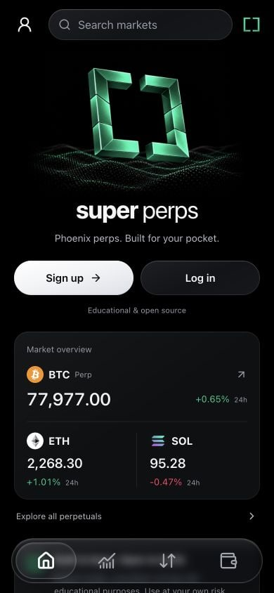
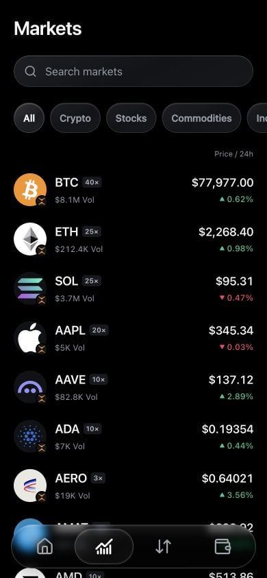
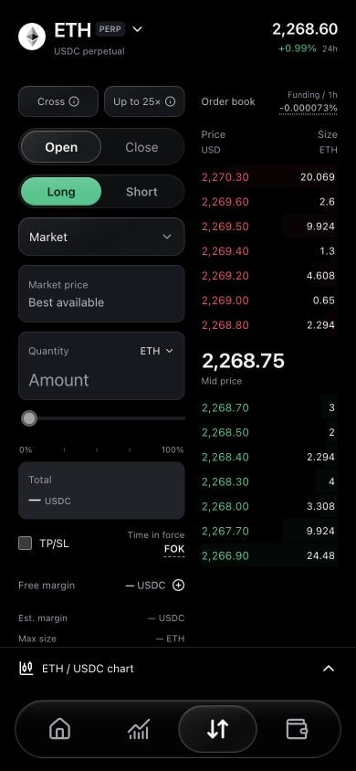
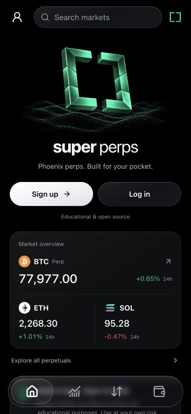

<p align="center">
  
</p>

<h1 align="center">super perps</h1>

<p align="center">
  <strong>A mobile web app for trading Phoenix perpetuals on Solana.</strong><br />
  An open-source educational example of market data, embedded wallets, collateral,
  and trading transactions in a React progressive web app (PWA).
</p>

<p align="center">
  <a href="#interface">Interface</a> ·
  <a href="#quick-start">Quick start</a> ·
  <a href="docs/README.md">Documentation</a> ·
  <a href="docs/architecture.md">Architecture</a> ·
  <a href="CONTRIBUTING.md">Contributing</a> ·
  <a href="docs/release-checklist.md">Release status</a>
</p>

<!-- Replace this placeholder with the permanent HTTPS website after deployment. -->
<p align="center"><strong>Website:</strong> coming soon · <a href="LICENSE">MIT license</a></p>

Learn from the implementation, fork it, or use individual parts in your own app.
Public market browsing works without credentials; wallet onboarding and trading
use your own provider configuration. The trading interface is designed for
phones, with a QR handoff for desktop visitors.

**React · TypeScript · Vite · Phoenix SDK · Privy · Solana Kit · PWA**

> **Educational and experimental.** This unaudited app can move real funds on
> Solana mainnet. Trading, leverage, liquidation, fees and software failures can
> cause losses. It is not financial advice and is provided **as is**, without
> warranties, under the [MIT license](LICENSE). Review and test any fork before use.

**0.1.0 release candidate.** See [release readiness](docs/release-checklist.md)
for documented testing, dependency findings and remaining acceptance checks.

## Interface

<p align="center">
  
  
  
</p>

<p align="center"><sub>Home · Market discovery · ETH order ticket</sub></p>

<details>
  <summary>View the interface tour (GIF)</summary>
  <p align="center">
    
  </p>
</details>

Screenshots and the GIF use actual app captures at a 390 × 844 browser viewport,
without a connected wallet. The GIF cycles through four captured screens.
Prices are historical snapshots; these images do not demonstrate trade execution.
See [capture details](docs/images/README.md).

## What you can build on

| Area          | Included                                                                                                  |
| ------------- | --------------------------------------------------------------------------------------------------------- |
| Discovery     | Home, searchable markets, category pills, venue badges, live volume and max leverage                      |
| Trading       | Cross-margin long/short market orders, GTC limits, native TP/SL and reduce-only closing                   |
| Charts        | Phoenix candles with average entry/P&L, resting limit and TP/SL trigger overlays                          |
| Account       | Privy email onboarding, primary embedded Solana wallet and automatic balance refresh                      |
| Funding       | Phoenix account setup, USDC collateral deposits/withdrawals, and direct wallet SOL/USDC transfers         |
| Risk and fees | Estimated liquidation prices, hourly funding, unsettled funding, trading fees and SOL fee/rent disclosure |
| Monetization  | Optional verified Flight builder routing and operator-configured referrals                                |
| Mobile shell  | Installable PWA, floating glass dock, safe areas, keyboard-aware sheets and reduced-motion support        |

The MVP uses **USDC collateral, cross margin, account 0 / subaccount 0**.
Market orders require a full fill within a 0.5% price bound. Isolated-only markets
can be viewed but not traded. Native TP/SL triggers do not guarantee a fill.
Equity includes unrealized P&L; free margin is a separate value.

Withdraw lets users choose **Phoenix collateral or Wallet** for USDC; SOL is sent
from the wallet. SOL **Max** deducts the quoted network fee before review and leaves
no SOL for later transactions. Every transfer still requires **Confirm & sign**.
Wallet sends do not require a Phoenix account; other tokens and memo-required
destinations are outside this version.

Adjustable leverage, one-click/delegated trading, automatic deposits, swaps and
gas sponsorship are outside this version. See [product scope](docs/product-scope.md)
for the intended boundaries and [monetization](docs/monetization.md) for fee details.

## Quick start

Use **Node 24** with npm. If you manage Node with nvm, run `nvm use` in the
cloned folder; other Node version managers work too. Run these commands yourself,
or ask your coding agent to run them. Public market browsing needs no credentials.

```sh
git clone https://github.com/merdanaslan/super-perps.git
cd super-perps
npm ci
cp .env.example .env.local
npm run dev
```

Open [the local app](http://127.0.0.1:5173). On a desktop, use
[the development phone preview](http://127.0.0.1:5173/?preview=mobile).
Production ignores `preview=mobile`; the viewport handoff is a layout choice,
not device authentication or an access restriction.

To enable login and transactions, follow [configuration](docs/configuration.md)
and [wallet setup](docs/wallet-setup.md). Use your own public Privy App ID and
private server `SOLANA_RPC_URL`. The included authenticated HTTP/WebSocket relay
keeps provider credentials out of the browser. Optional builder fees and referrals are off by default.
**All `VITE_*` values are public: never put wallet keys or server secrets in them.**

```sh
npm run build
npm run preview
```

Production preview runs on port 4173. For an installed phone test, follow the
[HTTPS/PWA guide](docs/pwa-testing.md). For hosting, see
[deployment](docs/deployment.md); a Vercel configuration is included.

A public fork does not change this project's hosted site. When using Vercel's
Git integration, only changes pushed or merged into your configured production
branch update production. See [deployment controls](docs/deployment.md#github-and-production-updates)
and [public versus private configuration](docs/configuration.md#what-is-public)
before connecting providers or enabling automatic deployments.

## Builder codes and app fees

**This educational starter adds no app builder fee by default.** Leave both
builder settings blank to trade without Flight routing. If you have a registered
builder authority and want to keep Flight routing, set
`VITE_PHOENIX_BUILDER_FEE_BPS=0`: the app encodes an explicit **0 bps (0%)**
override, even if that builder has a higher registered default.

[Phoenix Flight](https://flight.phoenix.trade) is the builder-code dashboard for
registering an integration, choosing a fee and managing builder earnings.
Builder fees are an optional additional charge on supported taking fills;
**zero builder fees do not remove Phoenix trading fees, funding or Solana fees.**
The public template contains no creator builder authority or referral code.

Forks can opt into paid routing using their own registered rate. Every order
review discloses the configured fee before signing. See
[Phoenix's builder-code overview](https://docs.phoenix.trade/builder-codes) and
the [setup and verification guide](docs/monetization.md) for configuration,
fee caps, supported fills and the separate referral program.
For a code walkthrough, see [how the fee reaches the signed order](docs/monetization.md#follow-the-fee-through-the-code),
including the difference between a registered default and an explicit zero override.

## How funds and approvals work

1. Receive **USDC and SOL on Solana** in the app wallet. USDC is collateral;
   SOL pays network fees and account rent. The app does not sponsor fees or swap tokens.
2. Review Phoenix account setup, then review the deposit. Setup alone does not
   move the wallet's USDC. Each step has its own approval.
3. Review a simulated action and choose **Confirm & sign**. Privy signs those exact
   bytes without a duplicate transaction popup. This is not a delegated session.
4. Wait for confirmation and account reconciliation. Pending receipts survive
   reloads; an ambiguous submission blocks another action until checked.

Wallet USDC and Phoenix equity remain separate. Logging in, browsing or opening
a review does not sign a transaction. Do not clear storage to bypass a pending
receipt. See [architecture](docs/architecture.md#transaction-lifecycle) for the
implementation and [funding design](docs/funding-abstraction.md) for the decisions.

## Code map

| Path                                                                                   | Responsibility                                                       |
| -------------------------------------------------------------------------------------- | -------------------------------------------------------------------- |
| [`src/app/`](src/app/)                                                                 | Screens, reusable UI, routing and public market streams              |
| [`src/trading/types.ts`](src/trading/types.ts)                                         | Action, account and review contracts, including amount units         |
| [`src/trading/service.ts`](src/trading/service.ts)                                     | Phoenix account reads, SDK margin calculations and action builders   |
| [`src/trading/context.tsx`](src/trading/context.tsx)                                   | Review lifecycle, account refresh, cross-tab locking and recovery    |
| [`src/trading/chain.ts`](src/trading/chain.ts), [`execute.ts`](src/trading/execute.ts) | Simulation, exact-message signing checks and submission              |
| [`src/phoenix/`](src/phoenix/)                                                         | Canonical markets, exact amount validation and presentation adapters |
| [`src/wallet/`](src/wallet/)                                                           | Privy integration, app-wallet resolution and signing boundary        |
| [`api/`](api/), [`server/`](server/)                                                   | Hosted entry points, authenticated RPC relay and credential guards   |
| [`src/pwa/`](src/pwa/)                                                                 | Static-only cache, offline state and deferred updates                |
| [`src/lab/`](src/lab/), [`scripts/`](scripts/)                                         | Unsigned diagnostics and repository checks                           |

Start with the [architecture guide](docs/architecture.md) for the provider tree,
data flow, transaction safeguards and suggested extension points. The
[documentation index](docs/README.md) separates setup guides from dated research
and verification records.

## Checks and contributing

```sh
npm run check          # types, formatting, source hygiene and tests
npm run build          # production app + service worker
npm run licenses:check # generated dependency inventory/notices
npm run audit:release  # fails on high/critical dependency advisories
```

`npm run release:check` runs all release gates. The audit currently has
[open findings](docs/release-findings.md); CI deliberately keeps that gate visible.
Automated tests use mocks and ephemeral keys, not live funds. The optional public
probes construct unsigned transactions only; **never fund a probe address**.

Read [CONTRIBUTING.md](CONTRIBUTING.md) for the development workflow,
[SECURITY.md](SECURITY.md) for vulnerability reporting and
[CHANGELOG.md](CHANGELOG.md) for release notes. Contributions that improve
clarity, accessibility, tests and documentation are especially useful for a starter.

## Why this exists

This project provides a working example to study, fork and extend when building
mobile perpetuals apps, including projects for Solana's
[Perps and Prediction Markets hackathon](https://hackathons.solana.com/hackathons/perps-and-prediction-markets).
It is not an official hackathon template or an official Phoenix client, and no
endorsement, entry eligibility or prize qualification is implied. Consult the
event's current rules before submitting a project.

The [video walkthrough outline](docs/video-walkthrough.md) offers a short teaching
path through the app and code. A published video link will be added when available.

## License and credits

Original project source is licensed under [MIT](LICENSE). In plain language:

- You can use, modify, share and sell the code, including in commercial projects.
- Keep the copyright and license notice in copies or substantial portions.
- The code comes with no warranty; the license includes a liability disclaimer.

Educational intent does not restrict those permissions or require forks to be
open source. The [full license](LICENSE) governs the original code. Dependencies,
provider services and third-party marks retain their own terms; MIT does not
relicense them. Keep chart attribution and other applicable notices when forking.

Built with Phoenix, Privy, Solana Kit, React, Vite, TradingView Lightweight Charts,
Base UI, Motion and Lucide.

See the [third-party inventory](docs/third-party.md),
[dependency notices](public/dependency-notices.txt),
[UI notices](public/third-party-notices.txt) and [artwork provenance](docs/brand-assets.md).
Some provider dependencies have custom terms; review them for your use.
