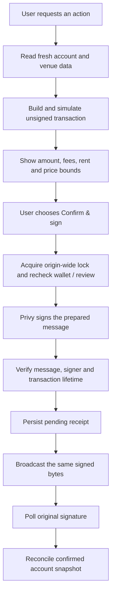

# Architecture and contributor map

super perps is a client-rendered React/TypeScript app. Vite builds its static UI;
two small server endpoints authenticate and relay Solana HTTP/WebSocket traffic.
There is no database, custody service or server-side signing key. Phoenix supplies the trading venue, Solana RPC supplies chain
reads/simulation/submission, and Privy supplies optional wallet onboarding/signing.

Read [product scope](product-scope.md) before expanding the MVP and
[configuration](configuration.md) before connecting your own providers.

## Start reading here

1. [`src/main.tsx`](../src/main.tsx) chooses the app or unsigned lab and installs
   the production service worker.
2. [`src/app/App.tsx`](../src/app/App.tsx) owns screen navigation, the phone/desktop
   handoff and the provider tree below. [`useAppRoute.ts`](../src/app/useAppRoute.ts)
   keeps internal navigation in one browser-history entry while preserving URLs
   for reloads and deep links.
3. [`src/app/Trade.tsx`](../src/app/Trade.tsx) owns the current order draft and review
   request. Order-book presentation and account cards live in separate components.
4. [`src/trading/types.ts`](../src/trading/types.ts) defines the actions and review
   data. Then read the short [`execute.ts`](../src/trading/execute.ts) to follow
   signing, receipt persistence and submission in order, without the React UI.
5. [`src/trading/context.tsx`](../src/trading/context.tsx) connects that sequence
   to the UI. Follow `review` and `confirm`, then account refresh and pending-receipt
   recovery. Wallet changes invalidate work started by the previous wallet.
6. [`src/trading/service.ts`](../src/trading/service.ts) translates typed actions
   into Phoenix instructions; [`chain.ts`](../src/trading/chain.ts) handles the
   underlying Solana transaction checks.

For a first change, follow one action, such as `deposit`, from the screen through
`review`, `service.prepare` and `executeReviewed`. The service handles several
actions, so there is no need to understand every builder branch at once. Keep
shared financial checks on this path instead of creating a second submission flow.

```text
MarketProvider                 Public metadata and market streams
└─ WalletSessionProvider       Anonymous fallback or primary Privy app wallet
   └─ TradingProvider          Account reads, review, signing and recovery
      └─ MobileApp             Screens, navigation and funding sheet
```

A production viewport wider than 767px shows `DesktopHandoff` before mounting
these providers. `?preview=mobile` is development-only. This is a presentation
boundary, not an authentication or security boundary.

## Module responsibilities

| Module                           | Owns                                                                                   | Keep out of it                                           |
| -------------------------------- | -------------------------------------------------------------------------------------- | -------------------------------------------------------- |
| `app/`                           | Screens, draft inputs, accessible components and formatting                            | Direct signing/submission or invented balances           |
| `app/market-data.tsx`            | Public market metadata, quotes, order-book stream and candle polling                   | Private account state and approval state                 |
| `phoenix/`                       | SDK adapters, canonical market identifiers, exact order validation and funding display | Wallet credentials and app navigation                    |
| `trading/types.ts`               | Action/account/review contracts and units                                              | Runtime work and provider imports                        |
| `trading/service.ts`             | Fresh account/risk reads, venue instruction builders and broadcast transport           | User interaction or implicit approvals                   |
| `trading/context.tsx`            | Review lifecycle, wallet identity, locks, receipt journal and reconciliation           | Screen layout and market discovery                       |
| `trading/TransactionReview.tsx`  | Amount, fee and rent disclosure with confirm/refresh callbacks                         | Signing, expiry enforcement or network calls             |
| `trading/chain.ts`, `execute.ts` | Mainnet validation, simulation, exact signed-message checks and durable submission     | UI-only validation as the final authority                |
| `wallet/`                        | Primary embedded wallet resolution, session recovery and explicit signing adapter      | Automatic collateral sweeps or venue policy              |
| `pwa/`                           | Static precache, offline message and deferred updates                                  | Cached API responses, balances, quotes or signing data   |
| `api/`, `server/`                | Privy token verification, bounded HTTP/WS relay and private provider configuration     | Signing keys, transaction creation and automatic retries |

Keep `TradingContext` in `state.ts`, separate from its provider implementation,
so Fast Refresh does not replace the identity used by consumers. UI components
call `useTrading().review(...)`; they do not construct their own submission paths.

Shared visual materials live in `app/tokens.css` and `app/surfaces.css`; component
layout stays in `app/app.css`. See the [design system](design-system.md) before
adding another button or panel treatment.

## Private RPC transport

The browser defaults to `/api/solana` for both HTTP and WebSocket connections.
`wallet/rpc-session.ts` uses the existing Privy access token to establish a short
HttpOnly cookie through `/api/rpc-session`. `server/auth.ts` verifies its ES256
signature and claims against Privy's public JWKS; no app secret is needed.
Both relay transports verify the cookie and exact Origin before contacting the
fixed server-configured upstream. Vite dev/preview and the Vercel entry points
share this implementation. Public Phoenix streams remain direct.

The relay forwards the original signed bytes and original JSON response text,
preserving large Solana integers. It never signs, rewrites transactions or retries
submission. Confirmation still polls over HTTP only while a transaction is pending.
See [relay boundaries and limits](rpc-relay.md) before changing its policy.

## Data and units

`MarketProvider` owns the public SDK client. It releases streams while the page
is hidden. `useOrderBook` follows the selected symbol; Trade passes the same book
to its sizing reference and `OrderBook` component. Candles come from Phoenix's
canonical history endpoint. Display throttling preserves source timestamps.

`TradingProvider` reads the selected wallet's account periodically and on return
to the page. Wallet changes invalidate earlier reads. Preparing an action reads
fresh venue/account data again; the displayed preview is not trusted as the
source for transaction construction.

- User-entered amounts and prices are **decimal strings**. `app/decimal-input.ts`
  normalizes a single decimal comma from a localized keyboard before the draft
  reaches sizing or review. Mixed/grouped separators remain invalid; exact lot
  and tick validation stays in `trading/math.ts`.
- Execution quantities use `bigint` or SDK integer strings. Convert through
  [`math.ts`](../src/trading/math.ts), not `parseFloat` or floating-point multiplication.
- USDC and Phoenix quote lots have **6 decimals**. SOL balances/fees use
  **lamports, 9 decimals**. Base lots and price ticks are market-specific.
- Numeric chart coordinates and formatted prices are presentation values; do
  not feed them back into a transaction builder.
- Unknown, failed or stale data remains unknown. Wallet USDC, Phoenix equity,
  free margin and withdrawable collateral are different values.

The `*-view.ts` adapters create display models for positions, resting orders and
conditional exits. Chart overlays omit stale data. TP and SL cards identify their
individual leg even when Phoenix stores them in one conditional-order entry.

Assets reads portfolio history separately through `useEquityHistory` and the SDK's
`getTraderPortfolioValues` method. It requests 24 hours at 15-minute resolution,
refreshes every five minutes only while visible and online, and keeps results in
memory for the active trader. Returning to the app or reconnecting requests fresh
history. Assets also provides a refresh button for both balances and history,
preserving the chart while a read is in progress. Late responses from an earlier
wallet are ignored.
The [portfolio-values endpoint](https://docs.phoenix.trade/api/trader/get-trader-portfolio-values)
uses milliseconds for query bounds but seconds for response timestamps; its
`value` is already a display USDC amount. `phoenix/equity-history.ts` normalizes
these units without zero-filling missing snapshots. Phoenix can return the
unfinished interval with an `endTime` later than the request: its value is retained
at the request time, while intervals that have not started are rejected.

The chart adds one current point from the same fresh account equity used by the
Assets balance, including its receipt timestamp and quote-lot conversion. It
therefore follows the eight-second account refresh and post-confirmation refresh,
without fetching a full day's history on each balance update. Stale or mismatched
accounts never supply that endpoint. This is not a fabricated intra-interval
history: real historical zeroes and gaps remain, and a lone current point does
not create a trend. The chart includes cash flows and is never used for sizing,
margin checks or transaction construction.

## Transaction lifecycle



A review expires after 30 seconds. Signing checks expiry again and rejects a
changed wallet or expired blockhash. The origin-wide Web Lock prevents competing
app tabs from executing overlapping actions. The pending receipt is written to
`localStorage` **before broadcast**; if storage fails, submission does not proceed.

A timeout after broadcast is ambiguous, not proof of failure. The original
signature remains pending and blocks another financial action until reconciled.
Receipt updates merge under the same lock so a late response cannot overwrite
a newer receipt. Confirmation waits for a sufficiently recent account snapshot
before updating the draft/automatic dismissal state. Confirmation itself is not
proof that an order filled or an external recipient was credited.

[`execute.ts`](../src/trading/execute.ts) accepts injected signing, storage and
transport functions, allowing failure paths to be tested without funds. Keep its
sequence intact when refactoring. The wallet adapter suppresses Privy's duplicate
transaction prompt only because this app already collected explicit approval of
the exact reviewed transaction; it does not grant a persistent trading session.

The first deposit is a two-transaction journey: account setup, then deposit. The
entered USDC amount is carried forward, but each transaction receives a separate
review. This never authorizes sweeping future incoming funds.

Wallet sends use `wallet-balances.ts` and `wallet-transfers.ts` without Phoenix
registration or venue metadata. `TradingProvider` shares one wallet-balance request
with the Phoenix account reader but applies each result independently. Wallet send
receipts reconcile against the confirmed wallet slot; trading receipts still use
the Phoenix snapshot slot. `FundingWithdrawal.tsx` keeps asset/source selection
separate from transaction construction. SOL Max is resolved from the message fee
before review; signing always uses those exact prepared bytes.

## Where to make a change

| Change                         | Start here                                                                                     | Validate                                                                 |
| ------------------------------ | ---------------------------------------------------------------------------------------------- | ------------------------------------------------------------------------ |
| Visual style or motion         | `app/tokens.css`, `app/app.css`, `components/Sheet.tsx`, `SelectionTabs.tsx`                   | Phone width, keyboard, focus return, safe areas and reduced motion       |
| Order-book layout              | `app/components/OrderBook.tsx`                                                                 | Empty/stale states and a shared stream with the ticket                   |
| Account card layout            | `TradingAccountPanel.tsx`, `PositionCard.tsx`, `OpenOrderCard.tsx`, `ConditionalOrderCard.tsx` | Long/short, missing data, independent exit cancellation and busy actions |
| Order input or sizing          | `app/Trade.tsx`, `phoenix/presentation.ts`, `trading/math.ts`                                  | Decimal precision, tick alignment, close direction and stale data        |
| New financial action           | `trading/types.ts`, `service.ts`, review disclosure                                            | Fresh validation, simulation, rejection, expiry and receipt recovery     |
| Wallet provider                | `wallet/session.tsx`, `PrivySessionBridge.tsx`                                                 | Identity continuity before/after signing and exact-message verification  |
| Builder/referral configuration | `trading/monetization.ts`, `referral-auth.ts`                                                  | On-chain configuration checks, disclosure and optional-off state         |
| PWA or hosting                 | `pwa.config.ts`, `src/pwa/`, `vercel.json`                                                     | No runtime API cache, direct routes and no forced update during signing  |

Prefer small modules with one clear responsibility. Comment the reason for a
constraint, especially units, authority, freshness and ordering; do not restate
obvious JSX. Add abstractions when they clarify a real boundary, not to mirror
every component with a wrapper.

## Verification boundaries

Tests live next to the code they exercise. Run `npm run check`, both public and
provider-enabled builds, and the license/audit checks described in
[CONTRIBUTING.md](../CONTRIBUTING.md). UI smoke tests, SDK simulations, maintainer
reports and funded execution are different evidence. Record which one a change
actually has in [release readiness](release-checklist.md).
